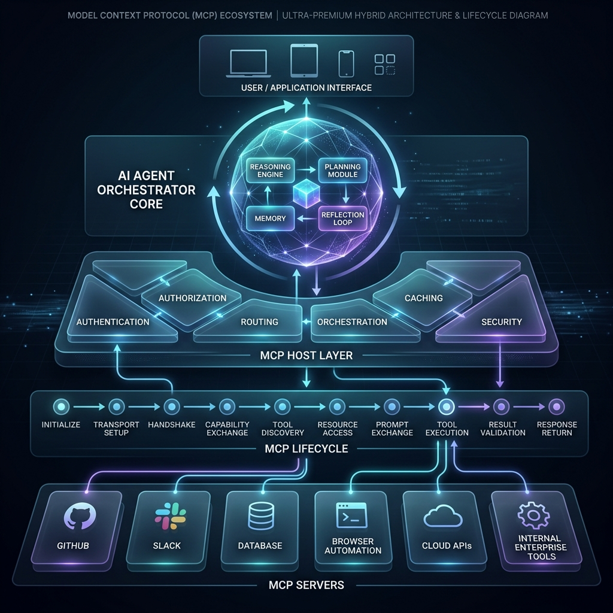

# MCP Masterclass 🎓

<div align="center">
  <p><em>The definitive guide to building production-ready AI agents with the Model Context Protocol.</em></p>
  
  
  
  
  
  <a href="EU_AI_ACT_TECHNICAL_DOCUMENTATION.md"></a>
  <a href="docs/adr/"></a>
  
</div>

<br/>

The **Model Context Protocol (MCP)** is an open standard that allows AI models to securely connect to external tools and datasets. This repository takes you from high-level architecture down to production-grade deployment, teaching you how to build robust, secure, and scalable MCP servers using Python and the `FastMCP` SDK.

---

## 📑 Table of Contents
- [Why This Masterclass?](#-why-this-masterclass)
- [The Anatomy of an AI Agent](#-the-anatomy-of-an-ai-agent)
- [Prerequisites & Quick Start](#-prerequisites--quick-start)
- [EU AI Act Technical Documentation](EU_AI_ACT_TECHNICAL_DOCUMENTATION.md)
- [Architecture Decision Records (ADRs)](docs/adr/)
- [Curriculum Syllabus](#-curriculum-syllabus)
  - [Theory: Chapters](#-theory-chapters)
  - [Practice: Labs](#-practice-labs)
  - [Mastery: Capstone Projects](#-mastery-capstone-projects)
- [Recommended Ecosystem Tools](#-recommended-ecosystem-tools)
- [Contributing](#-contributing)
- [License](#-license)

---

## 🌟 Why This Masterclass?

- 🚀 **Zero to Production**: Learn everything from basic protocol handshakes to advanced zero-trust security and multi-server orchestration.
- 🛠️ **FastMCP Native**: Built entirely on the modern, asynchronous Python SDK (`FastMCP`). No boilerplate, just business logic.
- 🛡️ **Enterprise Ready**: Deep dives into Human-in-the-Loop workflows, robust error handling, and secure binary data streaming.
- 🎓 **Hands-On Capstones**: Don't just read—build! Construct real-world agents like Clinical Copilots and Autonomous Dev Assistants.

---

## 🧠 The Anatomy of an AI Agent

Before building MCP servers, it's crucial to understand where MCP fits into the broader AI ecosystem. There are three primary **Participants**:

1. **MCP Host**: The AI application (like Claude Desktop, Cursor, or your custom app) that orchestrates the entire experience.
2. **MCP Client**: A component inside the Host that maintains the connection to servers and negotiates capabilities.
3. **MCP Server**: The service (what you will build) that provides tools, resources, and context to the Client.

As shown below, a production-grade AI Agent is a complex, multi-layered architecture:

<div align="center">
  
</div>

> **The MCP Layer** acts as the strict, standardized protocol boundary between the Agent Orchestration layer and your bottom-tier external tools. It ensures all tool routing, data fetching, and validation is secure and standardized.

---

## 💻 Prerequisites & Quick Start

If you are only reading the theoretical **Chapters**, no installation is required! However, to participate in the hands-on **Labs** and **Projects**, you will need:

- **Python 3.13+** installed on your system.
- An **API Key** from an LLM provider (e.g., Anthropic, OpenAI) for testing live agents.
- **Node.js** installed (required to run the MCP Inspector).

### Quick Start
```bash
# 1. Install the core SDK
pip install mcp

# 2. Navigate to the first lab
cd labs/lab-01-hello-mcp

# 3. Run your server using the official Inspector UI
npx @modelcontextprotocol/inspector python server.py
```

---

## 📚 Curriculum Syllabus

This masterclass is designed to be highly practical. We recommend the "Read, Build, Master" approach: read a chapter, execute the corresponding lab, and finish with the capstone projects.

### 📖 Theory: Chapters
*Learn the mental models and architectural patterns.*

- 📍 **Level 1: Foundations**
  - [Chapter 1: The Big Picture](chapters/01-the-big-picture/README.md)
  - [Chapter 2: Environment Setup](chapters/02-environment-setup/README.md)
  - [Chapter 3: The Handshake](chapters/03-the-handshake/README.md)
- 🏗️ **Level 2: Builder**
  - [Chapter 4: Tool Definition](chapters/04-tool-definition/README.md)
  - [Chapter 5: Resource Management](chapters/05-resource-management/README.md)
  - [Chapter 6: The Transport Layer](chapters/06-the-transport-layer/README.md)
- 🏛️ **Level 3: Architect**
  - [Chapter 7: Security & Auth](chapters/07-security-and-auth/README.md)
  - [Chapter 8: Prompts & Templates](chapters/08-prompts-and-templates/README.md)
  - [Chapter 9: Real-World Integration](chapters/09-real-world-integration/README.md)
  - [Chapter 10: Deployment & Scale](chapters/10-deployment-and-scale/README.md)
  - [Chapter 11: Client & Orchestration](chapters/11-client-and-orchestration/README.md)
  - [Chapter 12: Advanced Architecture](chapters/12-advanced-mastery/README.md)

### 🔬 Practice: Labs
*Build and test the core primitives locally.*

- 🧪 [Lab 1: Run MCP locally](labs/lab-01-hello-mcp/README.md)
- 🧪 [Lab 2: Build a tool server](labs/lab-02-tool-server/README.md)
- 🧪 [Lab 3: Add resource context](labs/lab-03-resource-server/README.md)
- 🧪 [Lab 4: Prompts & Templates](labs/lab-04-prompts-and-templates/README.md)
- 🧪 [Lab 5: Add security layer](labs/lab-05-secure-tools/README.md)
- 🧪 [Lab 6: Multi-server orchestration](labs/lab-06-multi-server-agent/README.md)
- 🧪 [Lab 7: GDPR PII Gateway & EU AI Act Audit Logger](labs/lab-07-gdpr-pii-gateway/README.md)

### 🏆 Mastery: Capstone Projects
*See how enterprise micro-servers orchestrate together to solve complex domain problems.*

- 💻 **[AI Dev Assistant](projects/ai-dev-assistant/README.md)** - Expose Git and linters; build an agent that fixes its own bugs.
- 🏥 **[Clinical Copilot](projects/clinical-copilot/README.md)** - Implement zero-trust PII scrubbing and Human-in-the-Loop workflows for healthcare data.
- 📊 **[Data Agent](projects/data-agent/README.md)** - Turn an LLM into a SQL analyst by streaming database schemas via Resources.
- 🗺️ **[Maps Grounding Agent](projects/maps-grounding-agent/README.md)** - Ground your AI in reality using the official Google Maps MCP server.

---

## 🤝 Recommended Ecosystem Tools

To get the most out of MCP, we highly recommend integrating with these powerful frameworks:

- **[LangChain](https://www.langchain.com/)**: The industry standard framework for building context-aware reasoning applications. Perfect for acting as the Orchestrator/Client for your MCP servers.
- **[Agent Development Kit (ADK)](https://adk.dev/)**: An essential toolkit for rapidly developing, testing, and deploying intelligent agents that consume MCP tools.

---

## 🛠️ Contributing

We welcome contributions! If you have ideas for new labs, improvements to existing chapters, or bug fixes:
1. Fork the repository.
2. Create your feature branch (`git checkout -b feature/AmazingFeature`).
3. Commit your changes (`git commit -m 'Add some AmazingFeature'`).
4. Push to the branch (`git push origin feature/AmazingFeature`).
5. Open a Pull Request.

---

## 📄 License

Distributed under the MIT License. See `LICENSE` for more information.

---
<div align="center">
  <sub>Created by <a href="https://github.com/FirdowsRahaman">Firdows Rahaman</a></sub>
</div>