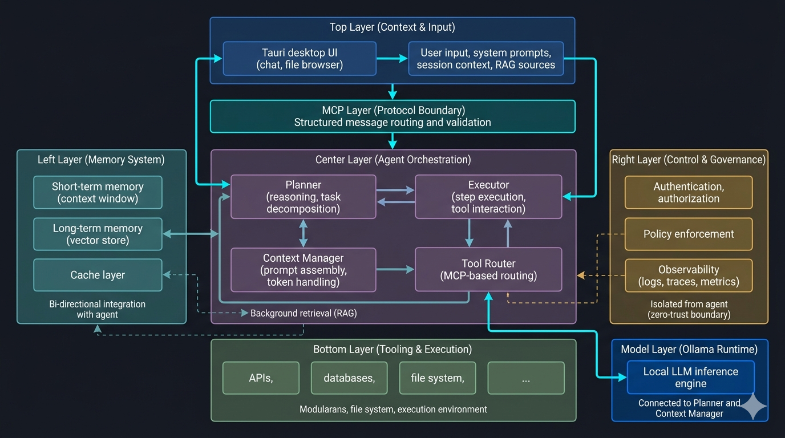

# MCP Masterclass
A comprehensive, end-to-end curriculum for mastering the Model Context Protocol (MCP). 

The Model Context Protocol is an open standard that allows AI models to securely connect to external tools and datasets. This repository takes you from high-level architecture down to production-grade deployment, teaching you how to build robust, secure, and scalable MCP servers using Python and the FastMCP SDK.

## The Anatomy of an AI Agent
Before building MCP servers, it's crucial to understand where MCP fits into the broader AI ecosystem. As shown below, a production-grade AI Agent is a complex, multi-layered architecture:

  

The architecture consists of several key layers:
- **Context & Input (Top)**: The user interface (e.g., Tauri Desktop UI) and raw inputs like system prompts and RAG sources.
- **Agent Orchestration (Center)**: The core loop containing the Planner, Executor, Context Manager, and Tool Router.
- **Memory System (Left)**: Short-term context windows, long-term vector stores, and caching.
- **Control & Governance (Right)**: Zero-trust boundaries enforcing authentication, authorization, and observability.
- **Model Layer**: The local inference engine (e.g., Ollama) providing the actual reasoning capabilities.
- **Tooling & Execution (Bottom)**: The external APIs, databases, and file systems.

**The MCP Layer** acts as the strict protocol boundary between the Agent Orchestration layer and the Bottom Tooling layer, ensuring all tool routing and validation is securely standardized.

## Prerequisites
If you are only reading the theoretical **Chapters**, no installation is required! However, to participate in the hands-on **Labs** and **Projects**, please ensure you have the following:
- **Python 3.10+** installed on your system.
- An **API Key** from an LLM provider (e.g., Anthropic, OpenAI) for testing agents.
- **MCP Inspector**: A debugging UI for protocol traffic. Install it via `npx @modelcontextprotocol/inspector`.

## How to Use This Guide
This masterclass is designed to be highly practical. We recommend the following approach:
1. **Read the Theory**: Start with the `chapters/` to understand the mental models and architectural decisions.
2. **Execute the Labs**: Immediately after reading a chapter, navigate to the `labs/` directory to build the concepts locally.
3. **Build the Projects**: Once you've completed the Builder level, tackle the Capstone `projects/` to see how enterprise micro-servers orchestrate together.

## Learning Path
- **Level 1: Foundations** (Chapters 1–3) - The Big Picture, Environment Setup, Handshake
- **Level 2: Builder** (Chapters 4–6) - Tool Definition, Resource Management, Transport Layer
- **Level 3: Architect** (Chapters 7–11) - Security, Prompts, Integrations, Scale, Orchestration

## Quick Start
1. Install [MCP Inspector](https://modelcontextprotocol.io/docs/tools/inspector)
2. Run the first lab: `cd labs/lab-01-hello-mcp && python start.py`

## Chapters
- [Chapter 1: The Big Picture](chapters/01-the-big-picture/README.md)
- [Chapter 2: Environment Setup](chapters/02-environment-setup/README.md)
- [Chapter 3: The Handshake](chapters/03-the-handshake/README.md)
- [Chapter 4: Tool Definition](chapters/04-tool-definition/README.md)
- [Chapter 5: Resource Management](chapters/05-resource-management/README.md)
- [Chapter 6: The Transport Layer](chapters/06-the-transport-layer/README.md)
- [Chapter 7: Security & Auth](chapters/07-security-and-auth/README.md)
- [Chapter 8: Prompts & Templates](chapters/08-prompts-and-templates/README.md)
- [Chapter 9: Real-World Integration](chapters/09-real-world-integration/README.md)
- [Chapter 10: Deployment & Scale](chapters/10-deployment-and-scale/README.md)
- [Chapter 11: Client & Orchestration](chapters/11-client-and-orchestration/README.md)

## Labs
- [Lab 1: Run MCP locally](labs/lab-01-hello-mcp/README.md)
- [Lab 2: Build a tool server](labs/lab-02-tool-server/README.md)
- [Lab 3: Add resource context](labs/lab-03-resource-server/README.md)
- [Lab 4: Prompts & Templates](labs/lab-04-prompts-and-templates/README.md)
- [Lab 5: Add security layer](labs/lab-05-secure-tools/README.md)
- [Lab 6: Multi-server orchestration](labs/lab-06-multi-server-agent/README.md)

## Projects
- [AI Dev Assistant](projects/ai-dev-assistant/README.md) - GitHub + Code tools, Fix bugs automatically
- [Clinical Copilot](projects/clinical-copilot/README.md) - Patient data → diagnosis tools, Safe tool execution
- [Data Agent](projects/data-agent/README.md) - BigQuery / SQL tools, Analytics via MCP

## Recommended Ecosystem Tools
To get the most out of MCP, we highly recommend integrating with these powerful ecosystem tools:
- **[LangChain](https://www.langchain.com/)**: The industry standard framework for building context-aware reasoning applications. Perfect for acting as the Orchestrator/Client for your MCP servers.
- **[Agent Development Kit (ADK)](https://adk.dev/)**: An essential toolkit for rapidly developing, testing, and deploying intelligent agents that consume MCP tools.

Created by [Firdows Rahaman](https://github.com/FirdowsRahaman)