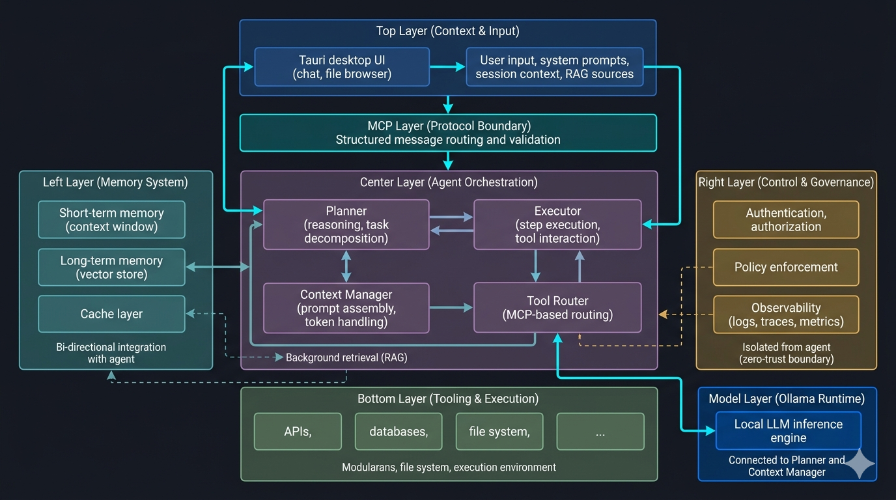
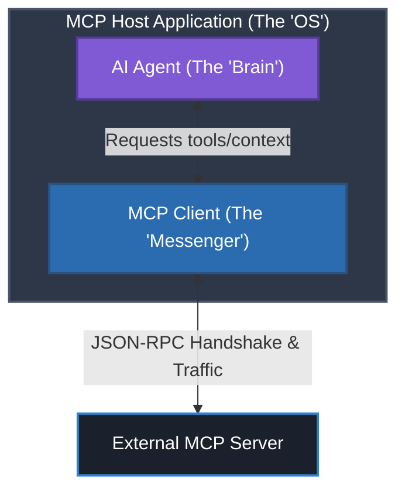
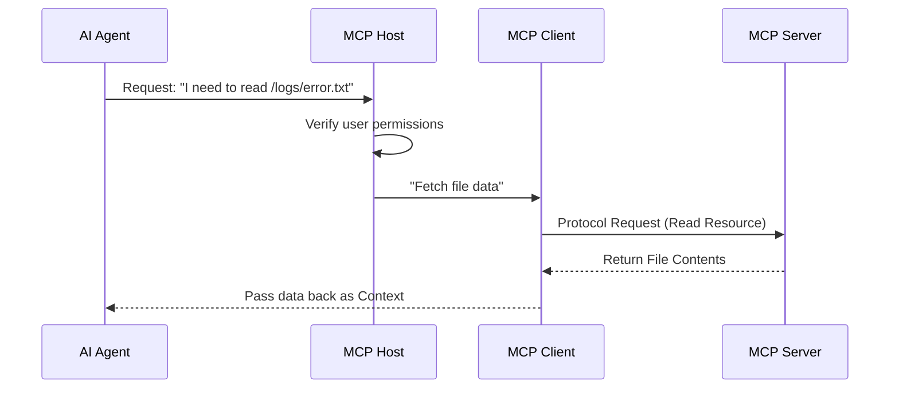
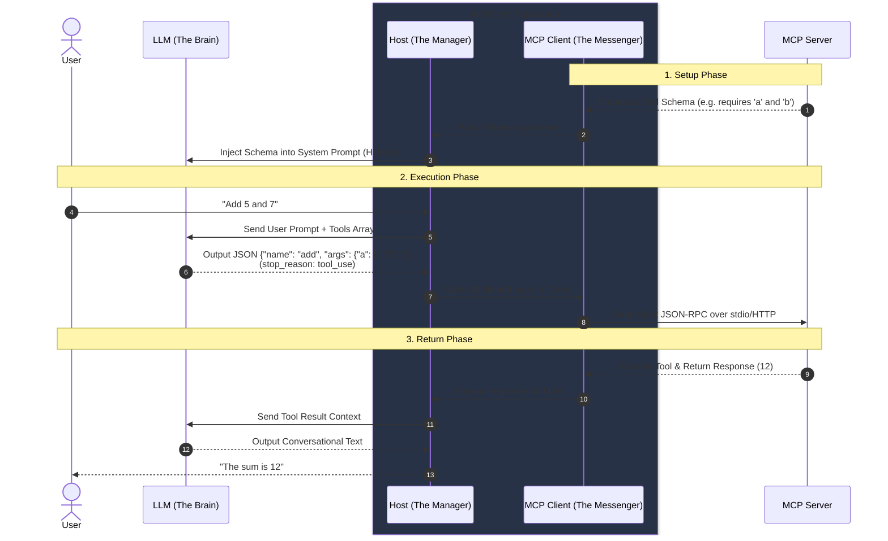

# Chapter 1: The Big Picture

<div align="center">
  
</div>

## Objective
In 10 minutes, you will understand:
- Why MCP exists as a protocol
- How MCP differs from traditional API approaches
- The Host/Client/Server separation model
- Core mental models for protocol design

## The Concept
The Model Context Protocol (MCP) creates a standardized way for AI applications to connect to data and tools. To understand the difference between the Host, the Client, and the AI Agent, it helps to think of them as layers of an onion.

### 1. The AI Agent: The "Brain"
The AI Agent is the high-level logic. It is the part of the system that "thinks," plans, and decides which actions to take.
- **Role**: It interprets your natural language (e.g., "Check my calendar and email my boss"), breaks it down into steps, and decides which tools it needs to call.
- **Distinction**: The Agent is protocol-agnostic. It doesn't care how the connection to the calendar happens; it just knows it needs "Calendar Tool A."

### 2. The MCP Host: The "Manager"
The MCP Host is the actual application or environment where the AI Agent lives (e.g., Claude Desktop, Cursor, or a custom Python app).
- **Role**: It acts as the container. It manages security, user permissions, and coordinates multiple connections at once.
- **Distinction**: If the Agent is the "Brain," the Host is the "Body" or the "OS." It provides the infrastructure for the Agent to exist and interact with the protocol.

### 3. The MCP Client: The "Messenger"
The MCP Client is a specific software component inside the Host that handles the actual communication with an MCP Server.
- **Role**: It translates the Agent's high-level intent into the strict technical language (JSON-RPC) required by the protocol. It maintains the "pipe" to the data source.
- **Distinction**: For every external service (like Google Drive, Slack, or a local Database), the Host might spin up a separate MCP Client to talk to that specific server.

### The Three Core Primitives
While most developers focus on actions, MCP actually standardizes three distinct types of capabilities:
1. **Resources**: Read-only data the AI can consume (e.g., local files, database schemas, live API responses). Think of this as giving the AI structured *context*.
2. **Tools**: Executable functions the AI can call to take action (e.g., executing a SQL query, sending an email, calculating a sum). Think of this as giving the AI *agency*.
3. **Prompts**: Pre-defined templates that help structure the AI's tasks. Think of this as giving the AI standardized *instructions*.

## How It Works

### Architectural 'Onion' Model


### Summary Comparison Table
| Component | Responsibility | Analogous To... |
|-----------|----------------|-----------------|
| **AI Agent** | Reasoning, decision making, and planning. | **The Executive**: Decides what work needs to be done. |
| **MCP Host** | Orchestration, security, and managing the UI/UX. | **The Office**: The environment where the executive works and tools are kept. |
| **MCP Client** | Technical connection, data translation, and message passing. | **The Phone**: The specific tool used to call an outside service. |

### How They Work Together
Let's look at an example where you ask the AI Agent for a summary of a local file:
1. **The AI Agent** realizes it needs access to the file system.
2. **The MCP Host** checks if you've given permission to access that folder.
3. **The MCP Host** tells the MCP Client to fetch the file data.
4. **The MCP Client** sends a standardized request to the **MCP Server** (the script actually reading your hard drive) and brings the data back to the Agent.



### Under the Hood: How Tool Calling Works
You might be wondering: *How does the "Brain" actually know what tools exist, and how does it execute them without outputting gibberish?*

This works via a native LLM feature called **Tool Calling** (or Function Calling).

#### 1. The Schema Injection
When the MCP Client connects to a Server, the Server broadcasts its tools as strict JSON schemas. The **Host** takes this schema and packages it into the LLM API request. It doesn't just jam it into the user prompt; modern LLM APIs have a dedicated `tools` array. 

Behind the scenes, the Host makes an API call that looks something like this:
```json
{
  "messages": [{"role": "user", "content": "Add 5 and 7"}],
  "system": "You are a helpful assistant.",
  "tools": [
    {
      "name": "add_numbers",
      "description": "Adds two numbers",
      "input_schema": { "a": "integer", "b": "integer" }
    }
  ]
}
```
Under the hood, the LLM provider injects this `tools` array into the System Prompt so the AI knows they exist, keeping it completely hidden from the user's visible chat history.

#### 2. The Dual-Mode Brain
If you just say "Hi", will the LLM still reply in that weird JSON format? No! Modern "Tool-Calling LLMs" (like Claude 3.5 Sonnet or GPT-4o) are specially trained to have two distinct modes of thinking:

- **Conversational Mode**: If you just say "Hi", the LLM analyzes the available tools and thinks: *"None of these tools are helpful for saying hello."* It outputs normal conversational text, and the API returns a flag indicating the turn is over (e.g., Anthropic's `stop_reason: "end_turn"`).
- **Action Mode**: If you say "Add 5 and 7", the LLM realizes a tool is needed. It immediately halts normal text generation and outputs a structured JSON block instead. The API returns a flag indicating a tool must be run (e.g., `stop_reason: "tool_use"`).

#### 3. The Translation
The LLM *cannot* execute code or make HTTP requests itself. It only outputs text/JSON. 

Because of the `tool_use` flag, the **Host** catches the JSON block, validates it, and hands it to the **MCP Client**. The Client then wraps it in the official `JSON-RPC 2.0` protocol format:

```json
{
  "jsonrpc": "2.0",
  "id": 1,
  "method": "tools/call",
  "params": {
    "name": "add_numbers",
    "arguments": {
      "a": 5,
      "b": 7
    }
  }
}
```
The Client then physically transmits this payload over the wire (either via an HTTP/SSE request or by writing it to the `stdio` pipeline of a local Python process).

#### Summary of the Flow


### Lifecycle Overview
- Initialize → Capabilities → Tool Discovery → Execution
- Each phase has standardized request/response structure
- State can be maintained between interactions

## MCP vs. Traditional APIs (REST/GraphQL)

If standard APIs like REST and GraphQL already exist to connect systems, why do we need a new protocol? 

Traditional APIs are built for **deterministic software**—code written by humans, expecting specific inputs, and returning predictable outputs. They are not optimized for **probabilistic AI agents**.

Here is why standard APIs fall short for AI, and how MCP overcomes these limitations:

1. **The Discovery Problem**
   - **REST APIs**: Require humans to read documentation (e.g., Swagger/OpenAPI), hardcode endpoints, and explicitly program the application to know which endpoint to call.
   - **MCP Solution**: Features built-in **Capability Negotiation & Tool Discovery**. When an MCP Client connects to an MCP Server, the server automatically broadcasts exactly what it can do and what parameters it needs. The AI agent dynamically discovers these capabilities at runtime.

2. **The Context Problem**
   - **REST APIs**: Are purely transactional (ask for data, get data). They don't provide a standardized way to stream rich context, memory, or complex application states to a reasoning engine.
   - **MCP Solution**: Provides standardized **Resources** (like file contents or database schemas) and **Prompts** alongside **Tools**. It exposes the entire "context" of a system to the LLM.

3. **The Lifecycle & State Problem**
   - **REST APIs**: Are typically stateless. Tracking the complex, multi-step reasoning loop of an AI agent across disparate API calls requires massive custom orchestration logic on the client side.
   - **MCP Solution**: Maintains stateful connections (via stdio or SSE). It handles the full lifecycle—from initialization to execution and graceful termination—providing a robust "pipe" designed specifically for AI workflows.

4. **The Security & Control Problem**
   - **REST APIs**: Often rely on broad API keys that grant wide-ranging access, making them risky to give to an autonomous agent that might hallucinate a destructive request.
   - **MCP Solution**: The MCP Host acts as a strict governance layer. By separating the AI Agent from the protocol boundary, the Host can enforce granular permissions, require human-in-the-loop approval, and strictly limit the agent's blast radius.

### A Concrete Example: Fetching Customer Data
Let's look at how an AI Agent gets data about "Customer #123" in both paradigms:

**The Traditional REST API Way**
1. The developer reads the API documentation for the CRM system.
2. The developer writes custom Python code to handle HTTP `GET /api/customers/123`, managing auth headers, retries, and JSON parsing.
3. The developer writes a custom prompt instructing the LLM: *"If you need customer data, output a JSON object like `{"action": "get_customer", "id": 123}`"*.
4. The application parses the LLM's response, triggers the custom Python code, and feeds the result back to the LLM.
*(Every new tool requires new custom glue code!)*

**The MCP Way**
1. The developer starts an MCP Server connected to the CRM.
2. The AI application (MCP Host) connects to this server.
3. The MCP Server automatically broadcasts: *"I have a tool called `get_customer`. It requires a numeric `id`. Here is the description."*
4. The AI application passes this standard capability list to the LLM natively.
5. The LLM decides to use it, the MCP Client sends a standard JSON-RPC request, and the data is returned.
*(Zero custom glue code needed! The Agent dynamically discovered and used the tool.)*

> [!NOTE]
> **Wait, couldn't I just give my AI an OpenAPI (Swagger) spec?**
> Yes, but it's not "plug-and-play." If you use a REST API, the AI Host application (like Claude Desktop or Cursor) still has to write custom logic to parse that OpenAPI spec, translate it into the specific tool-calling format the LLM requires (OpenAI's format is different from Anthropic's), and manage API-specific authentication. 
> 
> **MCP is like USB-C for AI Agents.** You write an MCP Server *once*. Instantly, **any** MCP-compatible client can connect to it and use its tools *without the Host application developer writing a single line of integration code*. It solves the N-to-M integration problem natively.

### Code Comparison: The "Glue Code" Problem

To make this concrete, here is exactly what developers had to write **before MCP** just to give an LLM one single tool, versus how it looks **with MCP**:

#### Before MCP (Manual Tool Calling)
You had to manually define schemas, handle LLM-specific formatting, parse the response, and execute the API manually. If you added 10 tools, you had massive `if/else` chains.

```python
import openai
import json
import requests

# 1. Manually define the tool schema (This format is ONLY for OpenAI!)
tools = [{
    "type": "function",
    "function": {
        "name": "get_customer",
        "description": "Get customer data by ID",
        "parameters": {
            "type": "object",
            "properties": {"id": {"type": "integer"}},
            "required": ["id"]
        }
    }
}]

# 2. Call the LLM
response = openai.chat.completions.create(
    model="gpt-4",
    messages=[{"role": "user", "content": "Get data for customer 123"}],
    tools=tools
)

# 3. Manually parse the LLM's decision
tool_call = response.choices[0].message.tool_calls[0]
if tool_call.function.name == "get_customer":
    args = json.loads(tool_call.function.arguments)
    
    # 4. Manually execute the HTTP request
    api_response = requests.get(f"https://crm.example.com/api/customers/{args['id']}")
    print(api_response.json())
```

#### After MCP (Using the FastMCP SDK)
With MCP, you just write your standard Python function. The protocol automatically translates it into the correct schema for *any* LLM (OpenAI, Claude, etc.) and handles the execution automatically.

```python
from mcp.server.fastmcp import FastMCP

mcp = FastMCP("Customer CRM")

# 1. Just write the Python function. The @mcp.tool decorator handles EVERYTHING else!
@mcp.tool()
def get_customer(id: int) -> str:
    """Get customer data by ID"""
    return f"Fetching data for customer {id} from database..."

if __name__ == "__main__":
    mcp.run()
```
*Claude Desktop, Cursor, Zed, or your custom app can now connect to this server and use the tool instantly, with zero client-side glue code!*

### Summary: Why MCP is More Convenient than REST APIs

To summarize, here is why developers find MCP significantly better and more convenient for building AI tools than traditional APIs:

1. **Write Business Logic, Not Glue Code**: You write standard Python functions (`def my_tool():`). The SDK handles all JSON-RPC framing, schema generation, and routing automatically.
2. **True Plug-and-Play**: You don't need to rebuild your API integrations for Claude, then OpenAI, then local models. One MCP Server works with *any* MCP-compatible AI host right out of the box.
3. **Automatic Discovery**: You don't have to train the AI on how to use your tool with massive custom system prompts. The protocol handles the capability broadcasting natively.
4. **Local and Secure by Default**: Unlike REST APIs that often require opening network ports or setting up webhooks, MCP can run locally over standard input/output (stdio). This makes it incredibly secure and fast for accessing local files, databases, and private environments without exposing your system to the internet.

## Try It Yourself
Let's see this in action by looking at a complete, working calculator server:

```python
# server.py
from mcp.server.fastmcp import FastMCP

mcp = FastMCP("calculator")

@mcp.tool()
def add(a: float, b: float) -> float:
    """Adds two numbers"""
    return a + b

if __name__ == "__main__":
    mcp.run()
```

1. **Install the Inspector**: Open your terminal and run `npx @modelcontextprotocol/inspector`. (Requires Node.js)
2. **Run the Server**: Save the code above as `server.py` and start it via the inspector:
   ```bash
   npx @modelcontextprotocol/inspector python server.py
   ```
3. **Observe the Handshake**: Open the browser URL provided by the inspector and observe the sequence:
   - Initialization request
   - Capabilities declaration
   - Tool discovery
   - Execution request/response

## Checkpoint
1. What are the three main components of MCP architecture?
2. How does MCP handle state differently than traditional API approaches?

## Architect Notes

### Trade-offs
- **Abstraction Cost**: Additional protocol layer adds minimal latency
- **Standardization Benefit**: Tool implementations become model-agnostic
- **Discovery Complexity**: Requires robust capability negotiation

#### A Polyglot Standard
One of MCP's greatest strengths is its language neutrality. While this masterclass focuses on Python and FastMCP, official SDKs are available for a wide range of ecosystems, including:
- **TypeScript/Node.js** (The reference implementation)
- **Python** (Ideal for AI/ML integrations)
- **C#, Go, Java, Rust, Kotlin, Swift, Ruby, and PHP**

This ensures that no matter where your data lives, you can build a bridge to the AI.

### Production Considerations
- **Handshake Observability**: Monitor success rates for initial capability negotiation.
- **Polyglot Strategy**: While we use Python, remember that the reference implementation is in TypeScript.
- **Idempotency**: Design tools to be safe for multiple LLM retries.