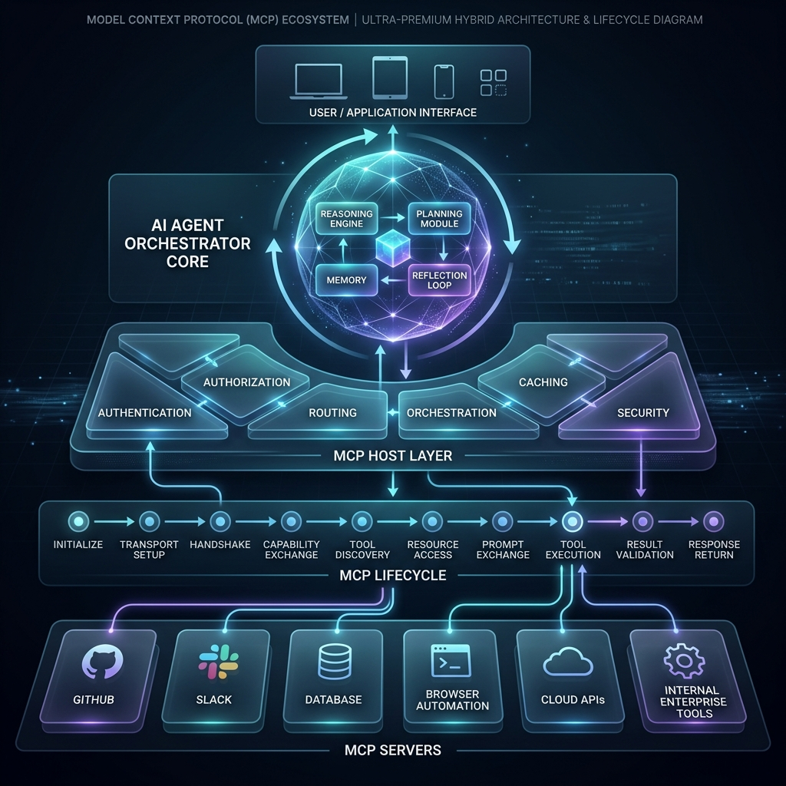

# Chapter 3: The Handshake & Protocol Lifecycle

## Objective
In 10 minutes, you will understand:
- The complete MCP protocol lifecycle phases
- Handshake sequence and message structure
- State management patterns (stateless vs stateful)
- How to debug protocol flow using MCP Inspector

## The Concept
MCP follows a well-defined lifecycle for every interaction. To understand the exact order of operations and "who calls whom," it helps to think of a restaurant.

### The "Restaurant" Analogy
**The MCP Handshake is like ordering food at a restaurant.**

<div align="center">
  
</div>

- **The Initialization (Reading the Menu)**: The MCP Client (Waiter) connects to the Server (Kitchen) and asks "What can you do?" The Server replies with its Capabilities (The Menu).
- **The Execution (Placing the Order)**: The AI Agent (Customer) decides it wants a specific tool. The Client (Waiter) takes this exact JSON-RPC order to the Server (Kitchen).
- **The Result (Serving the Food)**: The Server executes the Python code and hands the raw data back to the Client, which serves it to the Agent.

### Core Lifecycle Phases
1. **Initialize**: Establish connection parameters
2. **Capabilities**: Exchange feature support
3. **Tool Discovery**: Server advertises available tools
4. **Execution**: Request/response for tool operations
5. **Teardown**: Clean connection closure

## How It Works

### Protocol Lifecycle & Ecosystem
<div align="center">
  
</div>

### Detailed Sequence Flow

```mermaid
sequenceDiagram
    autonumber
    
    box rgb(40, 50, 70) MCP Host Application
    participant A as AI Agent
    participant C as MCP Client
    end
    
    participant S as MCP Server

    rect rgb(20, 40, 60)
    note right of C: Phase 1: Initialization
    C->>S: initialize (Protocol Version, Client Capabilities)
    S-->>C: result (Server Capabilities)
    C->>S: notifications/initialized (Ack)
    end

    rect rgb(30, 50, 40)
    note right of C: Phase 2: Tool Discovery
    C->>S: tools/list
    S-->>C: result (List of Tools & Schemas)
    end

    rect rgb(60, 30, 60)
    note right of A: Phase 3: Execution
    A->>C: LLM Request: "Use Tool X"
    C->>S: tools/call (JSON-RPC arguments)
    S-->>C: result (Execution Output)
    C-->>A: Context Injected: "Result is Y"
    end
```


### Message Structure
```json
{
  "jsonrpc": "2.0",
  "id": 1,
  "method": "tools/call",
  "params": {
    "name": "calculator.add",
    "arguments": {
      "a": 5,
      "b": 7
    }
  }
}
```

### State Management Patterns
| Pattern | Description | Use Case |
|---------|-------------|----------|
| Stateless | No context maintained between requests | Simple tool calls |
| Ephemeral | Context maintained per session | Multi-turn interactions |
| Persistent | Context stored externally | Long-running workflows |

## Under the Hood: The JSON-RPC Traffic
If you are using an SDK like FastMCP, **you do not write the handshake code yourself**. The SDK handles the entire lifecycle automatically.

However, if you look at the raw traffic in the MCP Inspector, this is exactly what the 3-step initialization handshake looks like over the wire:

**1. Client sends `initialize`:**
```json
{
  "jsonrpc": "2.0",
  "id": 1,
  "method": "initialize",
  "params": {
    "protocolVersion": "2024-11-05",
    "capabilities": {},
    "clientInfo": {
      "name": "Claude Desktop",
      "version": "1.0.0"
    }
  }
}
```

**2. Server responds with its Capabilities:**
```json
{
  "jsonrpc": "2.0",
  "id": 1,
  "result": {
    "protocolVersion": "2024-11-05",
    "capabilities": {
      "tools": {},
      "resources": {}
    },
    "serverInfo": {
      "name": "Calculator Server",
      "version": "1.0.0"
    }
  }
}
```

**3. Client sends an acknowledgement:**
```json
{
  "jsonrpc": "2.0",
  "method": "notifications/initialized"
}
```
*After this sequence, the connection is established and the Host can start requesting the actual list of tools!*

### What Exactly Gets Negotiated?
During this handshake, the Client and Server establish their boundaries. This is crucial because not all Hosts support all MCP features!

- **Client Capabilities**: The Host tells the Server what it allows. For example, does the Host allow the server to understand the user's workspace directory (`roots`)? Does it allow the server to trigger a sub-LLM call (`sampling`)? 
- **Server Capabilities**: The Server tells the Host what it can provide. For example: *"I have `tools` you can call, and `resources` you can read, but I do not have any `prompts`."*

If the Host (like Claude Desktop) doesn't support a specific feature that your Server requires, the handshake is the exact moment your server discovers this so it can gracefully degrade or throw an error.
## Try It Yourself

Let's observe this exact 3-step handshake in reality.

1. Open your terminal and start the inspector with your Chapter 1 calculator server:
   ```bash
   npx @modelcontextprotocol/inspector python server.py
   ```
2. Open the Inspector's browser UI (usually `http://localhost:5173`).
3. Click on the **Notifications** or **Messages** tab in the Inspector.
4. Scroll to the very top of the logs.
5. You will see the exact `initialize` request, the server's `result` response, and the `notifications/initialized` message.
6. Expand the JSON payload of the Server's response and notice how it broadcasts its `tools` capability to the Host!

## Checkpoint
1. What happens if capabilities negotiation fails during handshake?
2. How does context differ from state in MCP messages?

## Architect Notes

### Trade-offs
- **State Management**: Persistent state increases complexity but enables advanced workflows
- **Message Size**: Context payloads can grow large; implement pruning strategies
- **Error Recovery**: Design for resumable sessions after connection drops

### Production Considerations
- Implement message validation at each lifecycle phase
- Add timeouts for each protocol phase
- Monitor handshake success rates for integration health
- Use message IDs for request tracing and deduplication
- Plan for protocol version compatibility across components