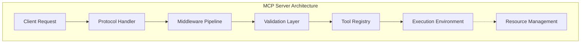

# Chapter 4: Tool Definition & Schemas

## Objective
In 10 minutes, you will understand:
- How to implement MCP servers using Python and TypeScript SDKs
- Server configuration and registration patterns
- Local development workflows for server testing
- Production deployment considerations

## The Concept
MCP servers act as the interface between the protocol and actual tool implementations. They handle request routing, validation, and execution while adhering to the MCP specification.

### The "Standard Operating Procedure" Analogy
**Writing an MCP Tool Schema is like writing an SOP for a new employee.**
If you just tell a brand new hire "fix the database", chaos will ensue. They don't know what database, what tools to use, or what "fix" means. 
You must give them a strict Standard Operating Procedure (SOP). 
A **JSON Schema** is the SOP for an LLM—it strictly defines the exact inputs, the expected data types, and the required outcomes so the AI doesn't hallucinate parameters.

### Core Components
- **Server Instance**: Manages protocol lifecycle
- **Tool Registry**: Catalog of available tools
- **Execution Context**: Environment for tool execution
- **Middleware Pipeline**: Request/response processing

## How It Works

### Server Architecture


### Implementation Flow
1. **Initialize Server**: Configure name, version, capabilities
2. **Register Tools**: Define tool functions with schemas
3. **Start Server**: Begin listening for MCP connections
4. **Handle Requests**: Process incoming tool requests

### Development Workflow
- Local testing with MCP Inspector
- Hot-reload during development
- Integration with host environments

## Code Example: Defining Tools with FastMCP

With FastMCP, defining a tool is as simple as writing a standard Python function and adding the `@mcp.tool()` decorator. The SDK automatically reads your Python type hints (`str`, `int`, etc.) and your docstring, converting them into the strict JSON Schema required by the MCP protocol.

### How Docstrings Power Tool Descriptions

When using FastMCP, the **docstring** of your Python function plays a critical role. The LLM relies on this description to understand *when* and *why* to use the tool. 

FastMCP extracts this information automatically:
- **Tool Description**: The main body of the docstring becomes the overall description of the tool.
- **Parameter Descriptions**: If you document parameters within the docstring (e.g., using standard Sphinx or Google style docstrings), FastMCP parses them into the schema so the LLM understands each specific argument.

**Best Practice:** Write clear, concise docstrings that explain exactly what the tool does, what it returns, and any side effects. Treat the docstring as the user manual for the AI.

```python
from mcp.server.fastmcp import FastMCP

# FastMCP automatically handles capabilities and routing
mcp = FastMCP("file-operations")

@mcp.tool()
def read_file(path: str) -> str:
    """
    Read contents of a file. 
    
    This is the main description of the tool that the LLM will see.
    FastMCP infers the schema from the type hints and this docstring.
    
    Args:
        path: The absolute path to the file to read.
    """
    with open(path, 'r') as f:
        return f.read()

@mcp.tool()
def write_file(path: str, content: str) -> bool:
    """
    Write content to a file.
    
    Args:
        path: The absolute path to the destination file.
        content: The string content to write into the file.
    """
    with open(path, 'w') as f:
        f.write(content)
    return True
```

### Structured Output with Pydantic
For complex tools, returning a plain string isn't always enough. You can return **Pydantic models** to provide the AI with a strict, machine-readable structure. FastMCP will automatically generate the JSON schema for the return type.

```python
from pydantic import BaseModel

class FileMetadata(BaseModel):
    path: str
    size: int
    encoding: str

@mcp.tool()
def get_metadata(path: str) -> FileMetadata:
    """Get detailed metadata for a file."""
    return FileMetadata(path=path, size=1024, encoding="utf-8")
```

### Context Injection and Progress Reporting
Often, tools need to log information, report progress for long-running tasks, or access client capabilities. FastMCP allows you to inject the current `Context` simply by adding it to your function signature. The AI will not be prompted to provide this parameter; FastMCP handles it under the hood.

```python
from mcp.server.fastmcp import Context

@mcp.tool()
async def process_large_dataset(dataset_id: str, ctx: Context) -> str:
    """Process a large dataset with progress updates."""
    
    # Send a log message back to the client
    ctx.info(f"Starting processing for {dataset_id}")
    
    # Report progress (e.g., 0 out of 100 steps)
    await ctx.session.send_progress_notification(
        progress_token=ctx.request_context.meta.progressToken,
        progress=0,
        total=100
    )
    
    # ... processing logic ...
    
    return "Processing complete!"
```

### Asynchronous Tools
Notice the `async def` in the example above. MCP and FastMCP fully support Python's `asyncio`. For tools that make network requests, read large files, or perform heavy I/O, always use asynchronous functions to prevent blocking the server.

### Returning Images
Tools aren't limited to returning text. If your tool generates a chart or retrieves a photo, you can return an `Image` object. The LLM will receive the base64 encoded image directly in its context window.

```python
from mcp.server.fastmcp import Image

@mcp.tool()
def get_chart() -> Image:
    """Return a generated chart as an image."""
    with open("chart.png", "rb") as f:
        image_data = f.read()
    
    # FastMCP's Image helper automatically formats it for the protocol
    return Image(data=image_data, format="png")
```

### Custom Error Handling
When a tool fails, you want the AI to know *why* so it can try to fix its mistake (e.g., if it passed a bad parameter). Instead of letting Python throw a stack trace, raise an `McpError`. This gracefully tells the LLM that the tool execution resulted in an error, allowing the LLM to read the error message and formulate a new plan.

```python
from mcp.shared.exceptions import McpError
from mcp.types import ErrorData, INTERNAL_ERROR

@mcp.tool()
def delete_file(path: str) -> str:
    """Delete a file. Throws an error if the file is protected."""
    if path.startswith("/system"):
        raise McpError(ErrorData(code=INTERNAL_ERROR, message="Cannot delete system files."))
    
    # ... deletion logic ...
    return f"Deleted {path}"

if __name__ == "__main__":
    # Start the server using stdio transport (standard for MCP)
    mcp.run()
```

## Try It Yourself

1. Create a new directory and file for your server:
   ```bash
   mkdir -p tool-server && cd tool-server
   touch server.py
   ```
2. Install the FastMCP SDK: 
   ```bash
   pip install mcp
   ```
3. Copy the code examples above into `server.py`.
4. Start the server via the Inspector: 
   ```bash
   npx @modelcontextprotocol/inspector python server.py
   ```
5. In the Inspector UI, click **Tools**. You should see `read_file`, `write_file`, and `get_metadata` beautifully formatted with their schemas!

## Checkpoint
1. How does FastMCP know what JSON schema to generate for a tool?
2. Why is a strict Standard Operating Procedure (JSON Schema) critical for LLMs?

## Architect Notes

### Trade-offs
- **Language Choice**: Python for rapid development vs TypeScript for type safety
- **Resource Management**: Direct access vs sandboxed execution
- **Error Handling**: Generic errors vs detailed debugging information

### Production Considerations
- Implement health checks and readiness probes
- Add request throttling and rate limiting
- Use structured logging for monitoring
- Implement graceful shutdown procedures
- Consider containerization for deployment consistency
- Design for horizontal scaling of stateless servers