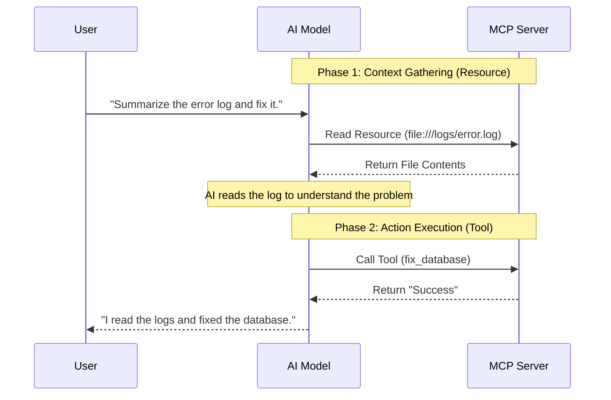

# Chapter 5: Resource Management

## Objective
In 10 minutes, you will understand:
- How to manage resources (files, databases) in MCP
- Context injection patterns for AI models
- Differences between RAG and MCP resource handling
- Security considerations for resource access

## The Concept
MCP enables AI models to access external resources through standardized interfaces. While Tools are for *taking action*, Resources are for *reading data*.

### The "Reference Library" Analogy
**Resources are the Reference Library; Tools are the Workshop.**
You wouldn't use a hammer to read a book. When an AI needs to understand context before acting, it doesn't "execute a tool"—it goes to the Reference Library.
The AI must ask the Librarian (the MCP Resource Manager) for a specific book (using a URI like `file:///logs/error.log`) to read *before* it takes any action in the workshop.



### Core Principles
- **Context Boundaries**: Clearly defined scope for resource access
- **Resource Lifecycle**: Proper initialization and cleanup
- **Execution Context**: Tools can use the `Context` object to access request metadata and stream logs back to the client.
- **Model Abstraction**: Models interact with resources through tools, not directly

## How It Works

### Resource Types Matrix
| Resource Type | Access Pattern | Security Model | Best For |
|---------------|----------------|----------------|----------|
| Local Files | Read/Write via tool | File permissions | Configuration, logs |
| Databases | Query interface | Row-level security | Structured data |
| APIs | Proxy calls | API keys, OAuth | External services |
| Knowledge Bases | Search interface | Content filtering | RAG implementations |

### Context Injection Patterns
1. **Explicit Injection**: Resources passed as tool parameters
2. **Implicit Context**: State maintained between interactions
3. **Context Window Management**: Prioritizing relevant information
4. **Metadata Enrichment**: Adding context about resource relevance

### RAG vs MCP Resource Handling
| Feature | Traditional RAG | MCP Resource Handling |
|---------|-----------------|------------------------|
| Access Control | Application-level | Protocol-level |
| Context Boundaries | Fixed window | Dynamic injection |
| Security Model | Per-application | Standardized |
| Error Handling | Custom | Standardized |

### Advanced FastMCP Features for Resources

Just like tools, resources in FastMCP support several advanced features to make them production-ready:
1. **Docstrings**: The LLM reads the docstring to understand exactly what data the resource provides.
2. **Asynchronous Execution**: Use `async def` for fetching from remote databases or reading large files without blocking the server.
3. **Context Injection**: You can inject the `Context` object into resources to log progress during slow reads.
4. **Binary Data**: Resources can return `bytes` instead of `str` for images, PDFs, or other binary formats.

### Code Example
```python
# Resource Server Implementation using FastMCP
from mcp.server.fastmcp import FastMCP, Context
import asyncio
import time

mcp = FastMCP("clinical-resource-server")

# Dummy database to keep the example self-contained
PATIENTS = {
    "123": "Patient 123: 45 yo male, history of hypertension.",
    "456": "Patient 456: 28 yo female, no known allergies."
}

# --- 1. Text Resource with Async and Context ---
@mcp.resource("clinical://patients/{patient_id}")
async def get_patient_data(patient_id: str, ctx: Context) -> str:
    """
    Fetch comprehensive patient records.
    The LLM uses this description to understand when to request this resource.
    """
    ctx.info(f"Fetching data for patient {patient_id}...")
    await asyncio.sleep(0.5) # Simulate database query
    return PATIENTS.get(patient_id, "Patient not found.")

# --- 2. Binary Resource ---
@mcp.resource("clinical://scans/{scan_id}.jpg")
async def get_patient_scan(scan_id: str) -> bytes:
    """Retrieve an MRI or X-Ray scan as binary image data."""
    # FastMCP automatically infers the mime type from the .jpg extension
    # and handles returning the binary bytes properly.
    return b"dummy_image_data" # In reality, read from a file

# --- 3. Tool: Execution Context Management ---
@mcp.tool()
def analyze_patient(patient_id: str, ctx: Context) -> str:
    """Analyze a patient's data. Demonstrates execution context logging."""
    # The ctx object allows us to stream progress logs back to the AI Client
    ctx.info(f"Starting analysis for {patient_id}...")
    
    time.sleep(1) # Simulate work
    ctx.info("Fetching lab results...")
    
    if patient_id.startswith("TEST"):
        ctx.warning("Using test patient data!")
        
    return f"Analysis complete for {patient_id}."

if __name__ == "__main__":
    mcp.run()
```

## Try It Yourself

Let's test both the Resource and the Tool.

1. Save the code above as `server.py`.
2. Start the Inspector:
   ```bash
   npx @modelcontextprotocol/inspector python server.py
   ```
3. Open the Inspector UI.
4. Click on **Resources**. You will see the `clinical://patients/{patient_id}` URI template. 
5. Try evaluating the resource by passing `123` as the `patient_id`. It will return the exact string from our dummy database.
6. Click on **Tools** and run `analyze_patient(patient_id="123")`. Watch the `ctx.info()` logs stream into the console in real-time as the tool executes!

## Checkpoint
1. When would you use implicit context vs explicit resource parameters?
2. How does MCP's security model differ from traditional RAG implementations?

## Architect Notes

### Trade-offs
- **Performance**: Direct database access is faster but less secure
- **Abstraction Cost**: Additional layer adds minimal latency
- **Context Size**: Large resources may exceed model context windows

### Production Considerations
- Implement resource access auditing and logging
- Design for resource failover and redundancy
- Use tokenization for sensitive data in context
- Monitor resource access patterns for anomalies
- Implement timeouts for resource operations
- Create resource health checks for production monitoring
- Consider data residency requirements for global deployments