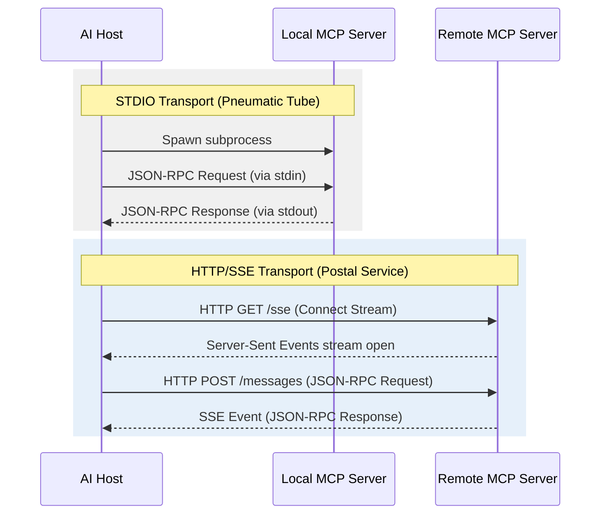

# Chapter 6: The Transport Layer

## Objective
In 10 minutes, you will understand:
- The difference between `stdio` and HTTP/SSE transport mechanisms
- When to choose which transport layer
- How to debug local `stdio` pipes using the `mcp-inspector`

## The Concept
MCP is transport-agnostic, meaning the core JSON-RPC messages are identical regardless of how they are sent over the wire. However, the choice of transport heavily impacts your deployment strategy and architecture.

### The "Pneumatic Tube" Analogy
**The Transport Layer dictates how the messages physically travel.**
- **`stdio` (The Pneumatic Tube)**: Like the vacuum tubes connecting two desks in the same bank building. It is instant, extremely secure (no one outside the building can intercept it), but physically limited. The Server MUST run on the exact same machine as the Host.
- **`SSE` (The Postal Service)**: Like the international postal service. It is infinitely scalable and can cross the globe, but it requires addresses (URLs), stamps (Authentication), and careful handling of lost packages (HTTP dropouts).

## How It Works



### 1. STDIO Transport
By default, MCP servers run locally. The AI Host (like Claude Desktop) spawns the MCP Server as a child subprocess and communicates directly via the `stdin` and `stdout` streams.

- **Pros**: Zero network overhead, implicitly secure (only the host can talk to it), incredibly easy to set up.
- **Cons**: Cannot be distributed. The server must run on the exact same physical machine as the AI host.
- **Warning**: Because `stdout` is used for the protocol, you **cannot** use `print()` in your Python code for debugging, as it will corrupt the JSON-RPC pipe! Use `ctx.info()` or the `logging` module configured to output to a file.

### 2. HTTP/SSE Transport
For remote execution, MCP uses Server-Sent Events (SSE). The Server exposes an HTTP endpoint. The Client connects to it, receives an SSE stream for incoming messages, and posts outgoing messages via standard HTTP POST.

- **Pros**: Highly scalable, allows one server to serve many distributed clients.
- **Cons**: Requires managing network security, authentication, and HTTP routing.

### Code Example: Launching SSE
```python
from mcp.server.fastmcp import FastMCP

mcp = FastMCP("remote-weather")

@mcp.tool()
def get_weather(city: str) -> str:
    return "Sunny"

if __name__ == "__main__":
    # Switching from stdio to SSE is a one-line change!
    mcp.run(transport="sse", port=8000)
```

## Try It Yourself

Let's experience the difference between STDIO and SSE transports.

1. Create a file named `server.py` and paste the SSE Code Example from above.
2. Run the server directly in your terminal:
   ```bash
   python server.py
   ```
   *Notice that the terminal now says it is listening on `http://127.0.0.1:8000`. It is acting as a web server!*
3. To test this SSE server, start the MCP inspector in a **new** terminal window:
   ```bash
   npx @modelcontextprotocol/inspector
   ```
4. Open the Inspector in your browser (`http://localhost:5173`). 
5. Instead of using the default "Command" setup, change the **Transport Type** dropdown to **SSE**.
6. Enter `http://127.0.0.1:8000/sse` as the URL and click Connect. You are now communicating with your MCP server over a network protocol!

## Checkpoint
1. Why must you avoid using `print()` when building a `stdio` MCP server?
2. When would you choose SSE over `stdio`?
