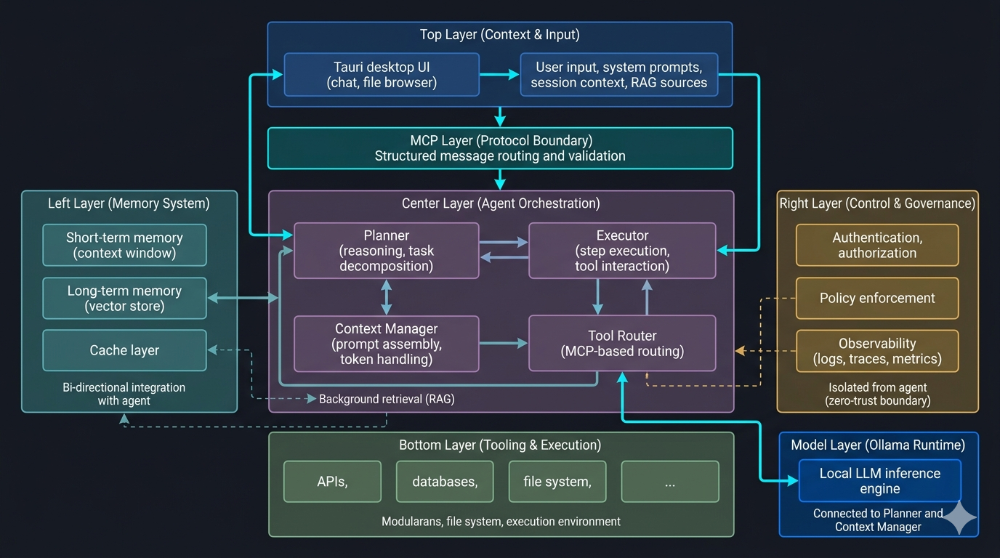

# Chapter 11: Multi-Server & Agent Orchestration

## Objective
In 10 minutes, you will understand:
- How to orchestrate multiple MCP servers in a single application
- Designing intelligent agent workflows that span multiple domains
- Routing tool requests effectively across server boundaries
- Handling cross-server dependencies and state management

## The Concept
As MCP applications grow in complexity, a single server is rarely sufficient. Multi-server orchestration allows you to compose specialized, single-purpose servers into a cohesive, powerful agentic system.

### The "General Contractor" Analogy
**MCP Orchestration is like hiring a General Contractor to build a house.**
When a User asks: *"Find my upcoming meetings and draft an email to the attendees."*
- **The Orchestrator (General Contractor)**: The main AI Agent. It realizes it cannot do this alone.
- **Server A (The Electrician)**: The Orchestrator calls the Calendar MCP Server *first* to get the data.
- **Server B (The Plumber)**: The Orchestrator takes the data from Server A, packages it up, and calls the Gmail MCP Server to write the email.

*Crucial Distinction*: Servers DO NOT talk to each other directly. They only ever talk to the Orchestrator, which acts as the central brain passing data between them.

### Core Principles
- **Separation of Concerns**: Each server handles a specific domain
- **Dynamic Routing**: Intelligently routing requests to the correct server
- **Unified Context**: Maintaining consistent state across server boundaries
- **Fault Tolerance**: Gracefully handling individual server failures

## How It Works

### The Anatomy of an AI Agent
Before we orchestrate multiple servers, we must understand what is actually making the decisions. As shown below, a production-grade AI Agent is a complex, multi-layered architecture:

<div align="center">
  
</div>

The architecture consists of several key layers:
- **Context & Input (Top)**: The user interface and raw inputs like system prompts and RAG sources.
- **Agent Orchestration (Center)**: The core loop containing the Planner, Executor, Context Manager, and Tool Router.
- **Memory System (Left)**: Short-term context windows, long-term vector stores, and caching.
- **Control & Governance (Right)**: Zero-trust boundaries enforcing authentication, authorization, and observability.
- **Model Layer**: The local inference engine (e.g., Ollama) providing the actual reasoning capabilities.
- **Tooling & Execution (Bottom)**: The external APIs, databases, and file systems.

**The MCP Layer** acts as the strict protocol boundary between the Agent Orchestration layer and the Bottom Tooling layer, ensuring all tool routing and validation is securely standardized.

### Multi-Server Architecture
```
┌─────────────────────────────────────────────────────┐
│                 Agent Orchestrator                  │
├─────────────────┬─────────────────┬─────────────────┤
│  Routing Logic  │  State Manager  │  Aggregator     │
└────────┬────────┴────────┬────────┴────────┬────────┘
         │                 │                 │
┌────────▼────────┐ ┌──────▼────────┐ ┌──────▼────────┐
│  Server A (DB)  │ │ Server B (FS) │ │ Server C (API)│
└─────────────────┘ └───────────────┘ └───────────────┘
```

### Routing Strategies
| Strategy | Description | Best For |
|----------|-------------|----------|
| Static Routing | Pre-configured mapping of tools to servers | Predictable, static toolsets |
| Semantic Routing | Using LLMs to determine which tool/server to use | Complex, overlapping tool domains |
| Capability-Based | Routing based on server capabilities handshake | Dynamic server connections |

### Orchestration Workflow
1. **Initialize**: Orchestrator connects and handshakes with all configured MCP servers.
2. **Aggregate Capabilities**: Combines tools and resources from all servers into a unified catalog.
3. **Analyze Goal**: Agent analyzes the user request and determines required tools.
4. **Execute & Route**: Orchestrator routes specific tool calls to the appropriate servers.
5. **Synthesize**: Agent combines the results from multiple servers into a final response.

### Code Example
> [!NOTE]
> *This example uses conceptual pseudo-code (`Orchestrator`) to illustrate how a multi-server architecture works. In practice, you would use an LLM framework (like [LangChain](https://www.langchain.com/) or [ADK](https://adk.dev/)) acting as an MCP client to orchestrate these connections.*

```python
# Multi-Server Orchestrator Implementation
from mcp import Client, Orchestrator

async def initialize_orchestrator():
    orchestrator = Orchestrator()
    
    # Connect to multiple specialized servers
    db_client = await Client.connect("localhost:8001")
    fs_client = await Client.connect("localhost:8002")
    api_client = await Client.connect("localhost:8003")
    
    # Register clients with the orchestrator
    orchestrator.register_server("database", db_client)
    orchestrator.register_server("filesystem", fs_client)
    orchestrator.register_server("external_api", api_client)
    
    return orchestrator

async def handle_agent_workflow(orchestrator, user_prompt):
    # Retrieve aggregated tool catalog
    tools = await orchestrator.get_all_tools()
    
    # Agent logic (simplified) selects tools based on prompt
    selected_tools = select_tools(user_prompt, tools)
    
    results = []
    for tool_call in selected_tools:
        # Orchestrator routes the call to the correct server
        result = await orchestrator.execute_tool(
            tool_name=tool_call.name,
            parameters=tool_call.parameters
        )
        results.append(result)
        
    return synthesize_response(results)
```

## Try It Yourself

1. Start three different MCP servers from previous labs (e.g., Hello MCP, Tool Server, Resource Server) on different ports.
2. Create an orchestrator script that connects to all three servers simultaneously.
3. Fetch and print the aggregated tool catalog.
4. Execute a workflow that requires reading a file from the file server and writing data to the database server.
5. Observe how the orchestrator handles routing and potential errors.

## Checkpoint
1. What are the challenges of managing context when an agent interacts with multiple servers?
2. How does capability aggregation help the LLM understand the available tools?

## Architect Notes

### Trade-offs
- **Modularity vs Complexity**: Splitting domains into multiple servers improves modularity but increases network overhead and orchestration complexity.
- **Centralized vs Decentralized**: A central orchestrator creates a single point of failure but simplifies state management compared to peer-to-peer server communication.

### Production Considerations
- Implement distributed tracing (e.g., OpenTelemetry) to track requests across multiple servers.
- Handle partial failures gracefully (e.g., if one non-critical server goes down, the agent should still function).
- Use connection pooling and keep-alives for persistent server connections.
- Design conflict resolution strategies for when multiple servers offer similar tools.
- Monitor network latency between the orchestrator and remote servers.
