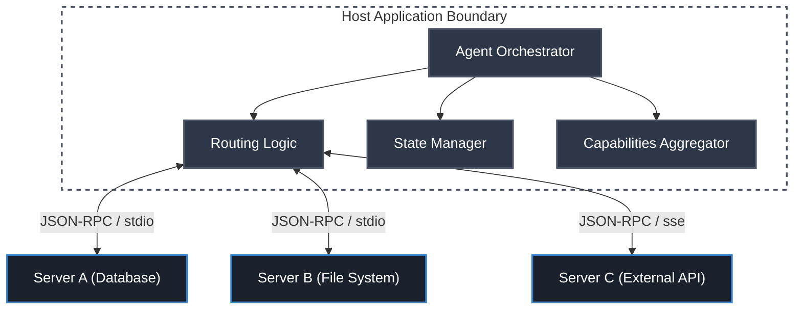

# Chapter 11: Multi-Server & Agent Orchestration

## Objective
In 10 minutes, you will understand:
- How to orchestrate multiple MCP servers in a single application
- Designing intelligent agent workflows that span multiple domains
- Routing tool requests effectively across server boundaries
- Handling cross-server dependencies and state management

## The Concept
As MCP applications grow in complexity, a single server is rarely sufficient. Multi-server orchestration allows you to compose specialized, single-purpose servers into a cohesive, powerful agentic system.

### The "General Contractor" Analogy
**MCP Orchestration is like hiring a General Contractor to build a house.**
When a User asks: *"Find my upcoming meetings and draft an email to the attendees."*
- **The Orchestrator (General Contractor)**: The main AI Agent. It realizes it cannot do this alone.
- **Server A (The Electrician)**: The Orchestrator calls the Calendar MCP Server *first* to get the data.
- **Server B (The Plumber)**: The Orchestrator takes the data from Server A, packages it up, and calls the Gmail MCP Server to write the email.

*Crucial Distinction*: Servers DO NOT talk to each other directly. They only ever talk to the Orchestrator, which acts as the central brain passing data between them.

### Core Principles
- **Separation of Concerns**: Each server handles a specific domain
- **Dynamic Routing**: Intelligently routing requests to the correct server
- **Unified Context**: Maintaining consistent state across server boundaries
- **Fault Tolerance**: Gracefully handling individual server failures

## How It Works

### The Anatomy of an AI Agent
Before we orchestrate multiple servers, we must understand what is actually making the decisions. As shown below, a production-grade AI Agent is a complex, multi-layered architecture:

<div align="center">
  
</div>

The architecture consists of several key layers:
- **Context & Input (Top)**: The user interface and raw inputs like system prompts and RAG sources.
- **Agent Orchestration (Center)**: The core loop containing the Planner, Executor, Context Manager, and Tool Router.
- **Memory System (Left)**: Short-term context windows, long-term vector stores, and caching.
- **Control & Governance (Right)**: Zero-trust boundaries enforcing authentication, authorization, and observability.
- **Model Layer**: The local inference engine (e.g., Ollama) providing the actual reasoning capabilities.
- **Tooling & Execution (Bottom)**: The external APIs, databases, and file systems.

**The MCP Layer** acts as the strict protocol boundary between the Agent Orchestration layer and the Bottom Tooling layer, ensuring all tool routing and validation is securely standardized.

### Multi-Server Architecture


### Routing Strategies
| Strategy | Description | Best For |
|----------|-------------|----------|
| Static Routing | Pre-configured mapping of tools to servers | Predictable, static toolsets |
| Semantic Routing | Using LLMs to determine which tool/server to use | Complex, overlapping tool domains |
| Capability-Based | Routing based on server capabilities handshake | Dynamic server connections |

### Orchestration Workflow
1. **Initialize**: Orchestrator connects and handshakes with all configured MCP servers.
2. **Aggregate Capabilities**: Combines tools and resources from all servers into a unified catalog.
3. **Analyze Goal**: Agent analyzes the user request and determines required tools.
4. **Execute & Route**: Orchestrator routes specific tool calls to the appropriate servers.
5. **Synthesize**: Agent combines the results from multiple servers into a final response.

### Code Example: Professional Client Orchestration
The following example demonstrates the **"Gold Standard"** for building an MCP Client that orchestrates multiple servers. It uses `AsyncExitStack` for robust lifecycle management and `ClientSession` for capability negotiation.

```python
import asyncio
from contextlib import AsyncExitStack
from mcp import ClientSession, StdioServerParameters
from mcp.client.stdio import stdio_client

class OrchestratorClient:
    def __init__(self):
        self.exit_stack = AsyncExitStack()
        self.sessions: dict[str, ClientSession] = {}

    async def add_server(self, name: str, command: str, args: list[str]):
        # 1. Define server parameters
        server_params = StdioServerParameters(command=command, args=args)
        
        # 2. Connect via stdio transport
        transport = await self.exit_stack.enter_async_context(stdio_client(server_params))
        read, write = transport
        
        # 3. Create and initialize session
        session = await self.exit_stack.enter_async_context(ClientSession(read, write))
        await session.initialize()
        
        self.sessions[name] = session
        print(f"Connected to {name}")

    async def list_all_tools(self):
        all_tools = []
        for name, session in self.sessions.items():
            response = await session.list_tools()
            all_tools.extend(response.tools)
        return all_tools

    async def cleanup(self):
        await self.exit_stack.aclose()

async def main():
    orchestrator = OrchestratorClient()
    try:
        # Orchestrate a custom Python server and the official Node.js SQLite server
        await orchestrator.add_server("custom-math", "python", ["server.py"])
        await orchestrator.add_server("sqlite", "npx", ["-y", "@modelcontextprotocol/server-sqlite", "/tmp/test.db"])
        
        tools = await orchestrator.list_all_tools()
        print(f"\nAggregated Catalog: {[t.name for t in tools]}")
        
    finally:
        await orchestrator.cleanup()

if __name__ == "__main__":
    asyncio.run(main())
```

## Try It Yourself

Let's run the Orchestrator Client you see above to prove that one central brain can talk to multiple different servers simultaneously.

1. Ensure you have the `server.py` (your FastMCP calculator server from Chapter 1) in your current directory.
2. Save the Orchestrator code example above as `orchestrator.py`.
3. Make sure you have the official MCP Python SDK installed (this provides the `ClientSession`):
   ```bash
   pip install mcp
   ```
4. Run the orchestrator script:
   ```bash
   python orchestrator.py
   ```
5. Look at the terminal output! You will see the script connect to both your custom Python server and the official SQLite server, pulling `add`, `read_query`, and `list_tables` all into one unified `Aggregated Catalog`.

*Note: This script is doing exactly what Claude Desktop does under the hood when it reads your config file!*

## Checkpoint
1. What are the challenges of managing context when an agent interacts with multiple servers?
2. How does capability aggregation help the LLM understand the available tools?

## Architect Notes

### Trade-offs
- **Modularity vs Complexity**: Splitting domains into multiple servers improves modularity but increases network overhead and orchestration complexity.
- **Centralized vs Decentralized**: A central orchestrator creates a single point of failure but simplifies state management compared to peer-to-peer server communication.

### Production Considerations
- Implement distributed tracing (e.g., OpenTelemetry) to track requests across multiple servers.
- Handle partial failures gracefully (e.g., if one non-critical server goes down, the agent should still function).
- Use connection pooling and keep-alives for persistent server connections.
- Design conflict resolution strategies for when multiple servers offer similar tools.
- Monitor network latency between the orchestrator and remote servers.
