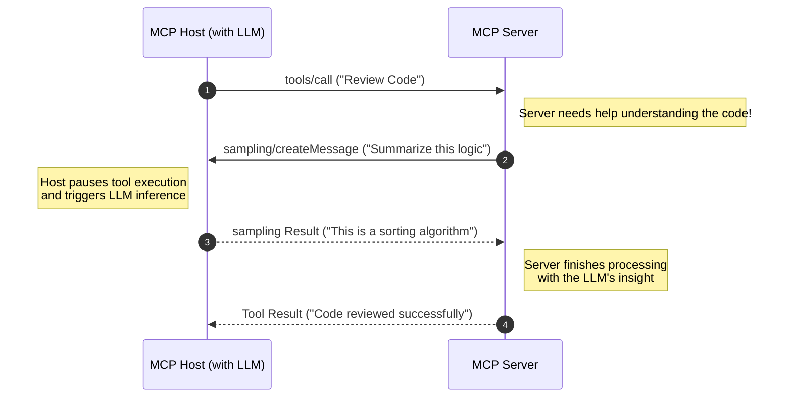

# Chapter 12: Advanced Architecture: Sampling, Metadata & Authorization

## Objective
In 10 minutes, you will understand the three most advanced features of the MCP specification:
- **Sampling**: How a server can "ask back" the LLM to perform tasks.
- **Roots**: Defining filesystem and URI boundaries for safe server operations.
- **Autocomplete**: Providing dynamic UI suggestions for prompt and resource arguments.
- **Visual Metadata**: Exposing UI icons and visuals for tools.
- **Advanced Authorization**: Using OAuth 2.0 and OpenID Connect.

## The Concept
Most MCP interactions are **Host -> Server** (The host asks the server for a tool or resource). Advanced patterns allow for **Server -> Host** interactions, where the server initiates a request to the host.

### 1. Sampling (The Recursive Agent)
Sampling is the most powerful feature of MCP. It allows a server to request that the host (the LLM application) perform a completion task.



**Example Use Case**: A "Code Review Server" gets a tool call to review a file. Instead of just using regex, it calls `sampling/createMessage` to ask the host's LLM: *"Please provide a high-level summary of the security risks in this code snippet."* 

The host then handles the LLM call and returns the result to the server, which can then finish its original task.

### 2. Roots (The Boundary)
Roots allow a server to understand the "workspace" it is operating in. A server can call `roots/list` to see which URIs (usually `file://`) the user has authorized for this session.

**Example Use Case**: A "File System Server" uses Roots to ensure it never tries to read files outside the project directory the user has opened in their IDE.

### 3. Autocomplete (The Smart UI)
MCP allows servers to provide dynamic autocompletion for Prompt arguments and Resource URI templates. 
When a user is filling out an argument in the host's UI, the Host can send a `completion/complete` request to the server with the partial user input.

**Example Use Case**: You have a `get_jira_ticket` tool. As the user types `PROJ-1...`, the MCP server dynamically queries the JIRA API and returns autocomplete suggestions like `PROJ-123 (Fix login bug)` directly into the Host's UI dropdown.

### 4. Visual Metadata (The Rich UI)
The latest specification allows servers to expose **Visual Metadata** (like SVG or PNG icons) alongside tools, resources, and prompts. This allows the host application to render a beautiful, contextual UI.

**Example Use Case**: A "GitHub Server" attaches the official GitHub logo to its `create_pull_request` tool, so when the user views available tools in Claude Desktop, they see a highly polished, recognizable interface.

### 5. Advanced Authorization
Production environments require enterprise-grade security. The protocol now natively supports **OpenID Connect Discovery 1.0** and **OAuth 2.0 incremental scope consent** via `WWW-Authenticate` headers. This allows servers to dynamically request additional permissions from the user mid-session.

## How It Works (Protocol Level)

### Sampling Request
When a server requests sampling, it can specify **Model Preferences** to guide the host's selection:
- `intelligencePriority`: (0.0 - 1.0) High values prefer more capable reasoning models.
- `speedPriority`: (0.0 - 1.0) High values prefer lower-latency models.
- `costPriority`: (0.0 - 1.0) High values prefer cheaper, efficient models.

```json
{
  "method": "sampling/createMessage",
  "params": {
    "messages": [
      {
        "role": "user",
        "content": { "type": "text", "text": "Summarize this log file: ..." }
      }
    ],
    "modelPreferences": { 
      "intelligencePriority": 0.9,
      "speedPriority": 0.2
    }
  }
}
```

### Autocomplete Request
```json
{
  "method": "completion/complete",
  "params": {
    "ref": {
      "type": "prompt",
      "name": "review_code"
    },
    "argument": {
      "name": "language",
      "value": "Pyth"
    }
  }
}
```

## Why It Matters
These features transform MCP from a "Stateless API" into a **Stateful, Interactive Protocol**. It enables:
- **Self-Correction**: Servers can ask the LLM for help when a tool fails (Sampling).
- **Context Awareness**: Servers know exactly where they are allowed to work (Roots).
- **Better UX**: The host application can guide users seamlessly with dynamic dropdowns (Autocomplete) and rich icons (Visual Metadata).
- **Enterprise Security**: Seamless token negotiation via OAuth 2.0.

## Try It Yourself

Let's test the **Roots** capability using the Inspector.

1. Ensure your current terminal directory is the root of your `mcp` folder.
2. Start the Inspector with the official Filesystem server, explicitly granting it access to your current directory:
   ```bash
   npx @modelcontextprotocol/inspector npx -y @modelcontextprotocol/server-filesystem ./
   ```
3. Open the Inspector UI. Try using the `list_allowed_directories` tool.
4. It will query the MCP `Roots` capability and return only the exact folder path you explicitly authorized!
5. This proves the server respects the security boundaries set by the Host.

## Checkpoint
1. What is the difference between an MCP Tool and MCP Sampling?
2. How does a server use Roots to prevent path traversal attacks?
