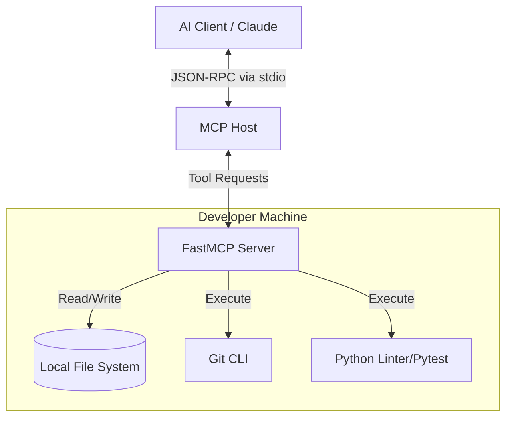

# Capstone Project: AI Dev Assistant

## Overview
The **AI Dev Assistant** is an autonomous coding agent built on MCP that interfaces directly with a developer's local environment. By exposing local file systems, Git commands, and linters via an MCP server, an AI client (like Claude Desktop) can read repositories, write code, create commits, and fix its own linting errors.

## Architecture

The system consists of an AI Host communicating with a local FastMCP Server that acts as a proxy to the local shell and file system.



## Core Server Implementation

This server relies heavily on tools for execution and validation. Notice how we use Pydantic models to strictly define the expected Git commit structure to prevent hallucinations.

```python
# dev_server.py
from mcp.server.fastmcp import FastMCP
from pydantic import BaseModel, Field
import subprocess
import os

mcp = FastMCP("ai-dev-assistant")

# --- Schemas ---
class CommitData(BaseModel):
    message: str = Field(description="Conventional commit message (e.g., 'fix: resolve null pointer')")
    files: list[str] = Field(description="List of specific files to stage. Use ['.'] for all.")

class LintData(BaseModel):
    directory: str = Field(default=".", description="Directory to run flake8/pytest against")

# --- Tools ---
@mcp.tool()
def git_commit(data: CommitData) -> str:
    """Stage files and create a Git commit. Only call this after verifying code passes linting."""
    try:
        # Stage files
        for file in data.files:
            subprocess.run(["git", "add", file], check=True, capture_output=True)
            
        # Commit
        result = subprocess.run(
            ["git", "commit", "-m", data.message], 
            check=True, capture_output=True, text=True
        )
        return f"Successfully committed:\n{result.stdout}"
    except subprocess.CalledProcessError as e:
        return f"Git Error: {e.stderr}"

@mcp.tool()
def lint_and_test(data: LintData) -> str:
    """Run flake8 linter and pytest. Returns the console output so the agent can fix errors."""
    try:
        result = subprocess.run(
            ["flake8", data.directory], 
            capture_output=True, text=True
        )
        if result.returncode != 0:
            return f"Linting Errors Found. Please fix these:\n{result.stdout}"
            
        return "Linting passed perfectly! Safe to commit."
    except FileNotFoundError:
        return "Error: flake8 is not installed in the current environment."

if __name__ == "__main__":
    mcp.run()
```

## Running the Project

### 1. Environment Setup
```bash
python -m venv venv
source venv/bin/activate
pip install fastmcp flake8
```

### 2. Connect via MCP Inspector
To test the tools safely before giving an AI full control:
```bash
mcp-inspector python dev_server.py
```

### 3. Connect via Claude Desktop
To actually use this as an assistant, add the server to your `claude_desktop_config.json`:
```json
{
  "mcpServers": {
    "dev-assistant": {
      "command": "/path/to/venv/bin/python",
      "args": ["/path/to/dev_server.py"]
    }
  }
}
```

Now you can tell Claude: *"Please review my python files, run the linter, fix any errors you find, and then commit the changes with a proper message."*

## Production Considerations
- **Sandboxing**: Executing arbitrary shell commands is dangerous. In a true enterprise environment, this server should run inside an isolated Docker container with mounted volumes.
- **Path Traversal**: Add validation to ensure the AI cannot modify files outside the designated workspace directory.
