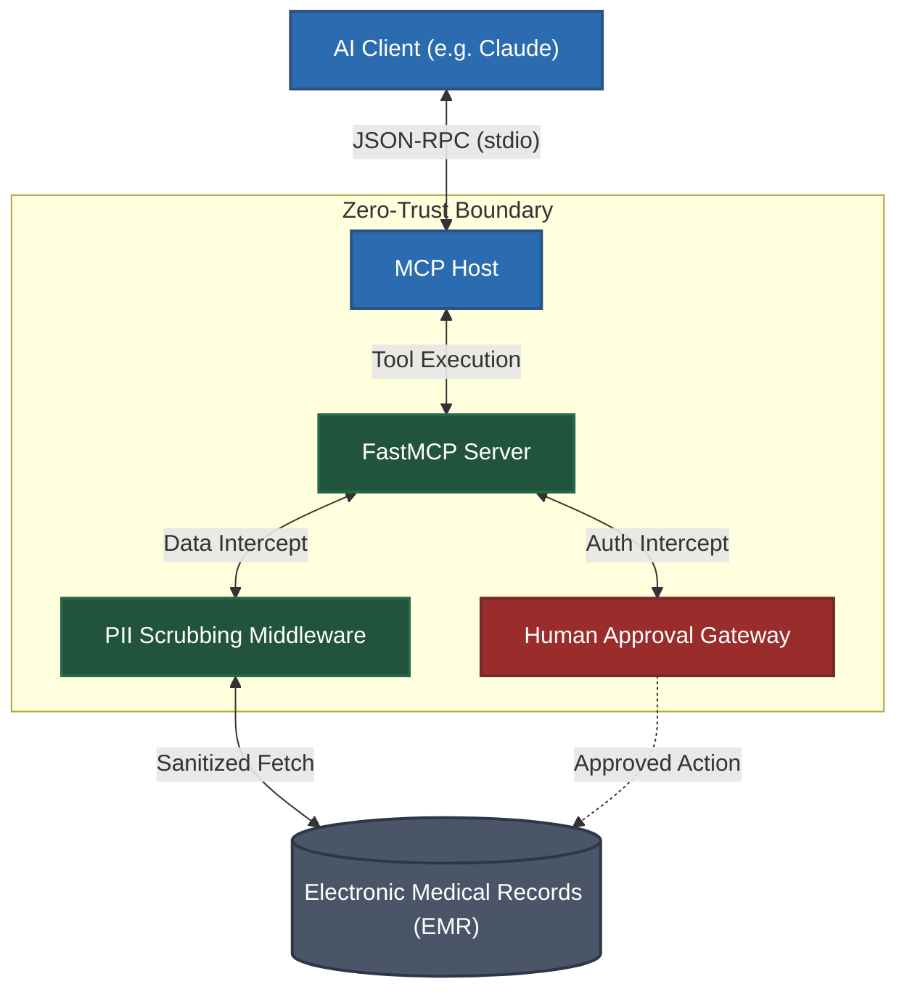

# Capstone Project: Clinical Copilot

<div align="center">
  
</div>

## Overview
The **Clinical Copilot** demonstrates how to deploy MCP in highly regulated environments like Healthcare, Finance, or Legal. It acts as a secure, zero-trust proxy between an AI Client and an Electronic Medical Record (EMR) system. 

Key features include **PII (Personally Identifiable Information) Anonymization** before data ever reaches the LLM, and **Human-in-the-Loop** execution for sensitive actions.

## Architecture

The MCP Server implements middleware to intercept and scrub data, ensuring the LLM only reasons over clinical facts, not patient identities.



## Core Server Implementation

This implementation highlights how to use FastMCP's `Context` to handle logging and how to implement application-level scrubbing logic.

```python
# clinical_server.py
from mcp.server.fastmcp import FastMCP, Context
import re

mcp = FastMCP("clinical-copilot")

# --- Mock EMR Database ---
MOCK_EMR = {
    "P12345": {
        "name": "Jane Doe",
        "ssn": "123-45-6789",
        "condition": "Type 2 Diabetes",
        "medications": ["Metformin"]
    }
}

# --- Middleware Utilities ---
def anonymize_clinical_data(data: dict) -> dict:
    """Strip PII before sending context to the LLM."""
    safe_data = data.copy()
    safe_data["name"] = "[REDACTED_NAME]"
    safe_data["ssn"] = "[REDACTED_SSN]"
    return safe_data

# --- Tools ---
@mcp.tool()
def get_patient_history(patient_id: str, ctx: Context) -> dict:
    """
    Retrieve clinical history for diagnosis.
    Returns safe, anonymized data for the LLM to analyze.
    """
    ctx.info(f"Audit Log: Accessing records for {patient_id}")
    
    if patient_id not in MOCK_EMR:
        return {"error": "Patient not found."}
        
    raw_data = MOCK_EMR[patient_id]
    
    # CRITICAL: Scrub data before returning to the model
    safe_data = anonymize_clinical_data(raw_data)
    return safe_data

@mcp.tool()
def prescribe_medication(patient_id: str, medication: str, human_approved: bool, ctx: Context) -> str:
    """
    DANGEROUS: Prescribes medication.
    The LLM MUST ask the user to explicitly say 'I approve' before setting human_approved=True.
    """
    if not human_approved:
        ctx.warning(f"Rejected unapproved prescription attempt for {medication}")
        return "SECURITY ERROR: You must present the prescription plan to the attending physician and receive explicit text approval before executing this tool."
        
    ctx.info(f"Audit Log: Executing approved prescription for {medication} to {patient_id}")
    # Execute actual API call to EMR here...
    return f"SUCCESS: {medication} has been added to the patient's chart."

if __name__ == "__main__":
    mcp.run()
```

## Running the Project

### 1. Environment Setup
```bash
python -m venv venv
source venv/bin/activate
pip install mcp
```

### 2. Connect via MCP Inspector
```bash
npx @modelcontextprotocol/inspector python clinical_server.py
```

### 3. Testing the Security Flow
1. Run `get_patient_history` with `P12345`. Notice how the resulting JSON returns `[REDACTED]` for the name and SSN, meaning the LLM never sees this data.
2. Run `prescribe_medication` with `human_approved=false`. See the tool reject the request.

## Production Considerations
- **HIPAA Compliance**: While MCP keeps data local to the host, sending any data to a cloud LLM (like Claude or OpenAI) requires a BAA (Business Associate Agreement) and enterprise APIs with zero data retention policies.
- **Robust Anonymization**: A simple dictionary pop is insufficient for production. You should integrate enterprise DLP (Data Loss Prevention) APIs like AWS Comprehend Medical or Google Cloud Healthcare API to detect and redact unstructured PII in clinical notes.
