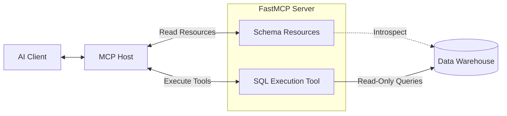

# Capstone Project: Data Agent

## Overview
The **Data Agent** turns an LLM into an expert Data Analyst. By utilizing MCP, we provide the model with a live view of database schemas via **Resources**, and the ability to execute read-only queries via **Tools**. This prevents the LLM from hallucinating table names or columns, leading to highly accurate SQL generation.

## Architecture

The FastMCP Server connects to a Data Warehouse (e.g., PostgreSQL, BigQuery, Snowflake) and securely exposes the schema and execution engine to the AI Host.



## Core Server Implementation

This implementation highlights the powerful synergy between Resources (for injecting schema context) and Tools (for execution).

```python
# data_server.py
from mcp.server.fastmcp import FastMCP
import sqlite3
import pandas as pd

mcp = FastMCP("data-agent")

# Initialize an in-memory database for demonstration
def setup_mock_db():
    conn = sqlite3.connect('sales.db')
    df = pd.DataFrame({
        'date': ['2023-01-01', '2023-01-02', '2023-01-03'],
        'product': ['Widget A', 'Widget B', 'Widget A'],
        'revenue': [100.50, 250.00, 150.75]
    })
    df.to_sql('daily_sales', conn, index=False, if_exists='replace')
    return conn

CONN = setup_mock_db()

# --- Resources (Context) ---
@mcp.resource("db://schema/public")
def get_database_schema() -> str:
    """
    Returns the complete database schema. 
    The AI should read this resource BEFORE attempting to write any SQL queries.
    """
    cursor = CONN.cursor()
    # SQLite specific schema query
    cursor.execute("SELECT sql FROM sqlite_master WHERE type='table';")
    schema_rows = cursor.fetchall()
    
    schema_text = "DATABASE SCHEMA:\n\n"
    for row in schema_rows:
        schema_text += f"{row[0]}\n\n"
        
    return schema_text

# --- Tools (Action) ---
@mcp.tool()
def execute_read_only_sql(query: str) -> str:
    """
    Executes a SELECT query against the data warehouse.
    Returns the results formatted as a Markdown table.
    """
    # 1. Security Check: Block destructive commands
    forbidden_keywords = ['DROP', 'DELETE', 'UPDATE', 'INSERT', 'ALTER', 'GRANT']
    upper_query = query.upper()
    if any(keyword in upper_query for keyword in forbidden_keywords):
        return "ERROR: Only SELECT queries are permitted by the Data Agent."
        
    try:
        # 2. Execute and format results using Pandas
        df = pd.read_sql_query(query, CONN)
        return f"Query Results:\n\n{df.to_markdown(index=False)}"
    except Exception as e:
        return f"SQL Execution Error: {str(e)}"

if __name__ == "__main__":
    mcp.run()
```

## Running the Project

### 1. Environment Setup
```bash
python -m venv venv
source venv/bin/activate
pip install fastmcp pandas tabulate
```

### 2. Connect via MCP Inspector
```bash
mcp-inspector python data_server.py
```

### 3. Usage Flow
1. First, navigate to the **Resources** tab in the Inspector and read `db://schema/public`. Notice how it perfectly describes the `daily_sales` table.
2. In a real interaction, the LLM reads this resource into its context window implicitly.
3. Switch to the **Tools** tab. Execute `execute_read_only_sql` with `SELECT product, SUM(revenue) FROM daily_sales GROUP BY product;`.
4. Observe the beautifully formatted Markdown table returned.
5. Try executing `DROP TABLE daily_sales;` to see the security filter in action.

## Production Considerations
- **Connection Pooling**: In production, use connection pooling (like SQLAlchemy or async drivers) rather than establishing a new connection per tool call.
- **Query Limits**: Add `LIMIT 1000` to user queries automatically within the tool logic, or paginate the results to prevent the LLM's context window from overflowing when querying large tables.
- **Database Roles**: Do not rely purely on Python keyword matching for security. The database user credentials provided to the MCP server should strictly possess `READ ONLY` grants at the database engine level.
